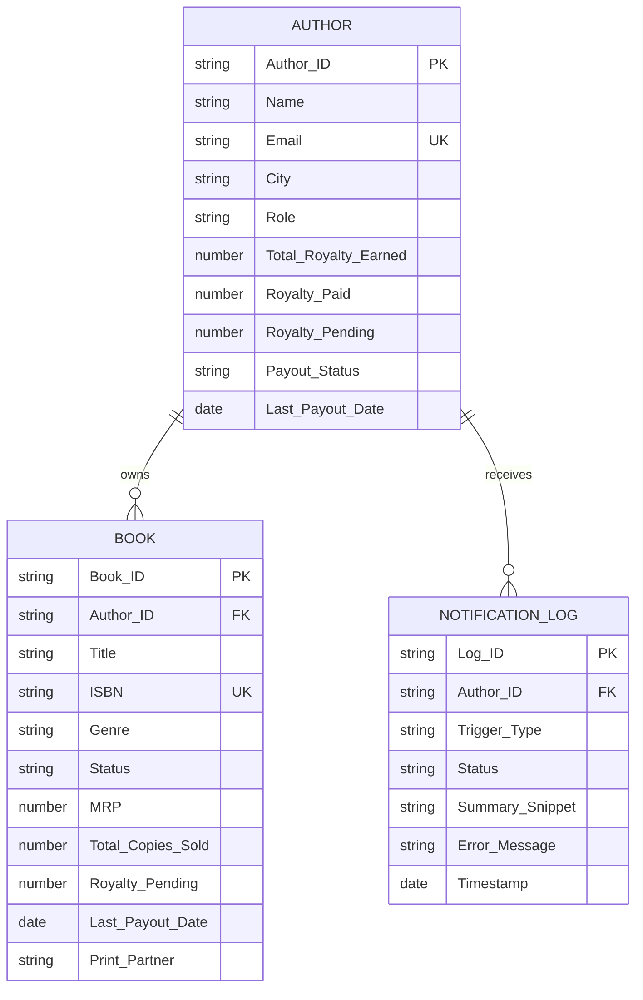

# BookLeaf Publishing — Technical Assignment 2 of 2
## Author Royalty Dashboard & Automated Notification System (Bubble.io + n8n + AI)

### 📌 Project Overview
This repository contains the architecture, workflow exports, database seed files, and configuration documentation for **BookLeaf Publishing's Technical Assignment 2**. The system provides a no-code operational platform on **Bubble.io** paired with an **n8n automation backend** and **Google Gemini AI** to automate royalty communication across BookLeaf's catalog of 22,000+ titles.

- **Platform Architecture:** Bubble.io (UI, Relational Database, RBAC) + n8n (Workflow Engine, Idempotency, AI Generation) + Google Gemini 2.5 Flash
- **Workflow Export:** [`n8n/bookleaf_royalty_workflow.json`](./n8n/bookleaf_royalty_workflow.json)
- **Database Seed CSVs:** [`bubble_seeds/authors.csv`](./bubble_seeds/authors.csv) & [`bubble_seeds/books.csv`](./bubble_seeds/books.csv)
- **Step-by-Step Bubble Blueprint:** [`BUBBLE_SETUP_GUIDE.md`](./BUBBLE_SETUP_GUIDE.md)

---

## 🗄️ 1. Bubble Database Schema & Relational Design

The database was structured to reflect a production relational publishing ERP while adhering to Bubble's native performance best practices:

### Why This Schema Was Chosen:
1. **Denormalized Financial Aggregates on `Author`**: Storing `Total_Royalty_Earned` and `Royalty_Pending` directly on the `Author` record eliminates complex multi-table sum calculations on repeating groups, keeping the Bubble UI snappy and responsive even on the free tier.
2. **Dedicated `NotificationLog` Entity**: Decouples automated notifications from core catalog tables. This ensures an immutable audit trail of every AI-generated summary, timestamp, and status code (Success/Failed) without mutating author records.
3. **Traffic-Light Status Computations**: The `Payout_Status` (`FULLY_PAID`, `PENDING`, `OVERDUE`) and 90-day overdue thresholds are computed cleanly in Bubble conditionals using `Last_Payout_Date`.

---

## 🔄 2. Bubble ↔ n8n Integration Architecture

The integration between Bubble and n8n follows a resilient, decoupled webhook architecture:

1. **Outbound Dispatch (Bubble → n8n)**:
   - When an admin clicks **"Generate & Send Royalty Summary"** (or the **"Bulk Trigger"** button), Bubble's API Connector fires a `POST` request to `/webhook/bookleaf-royalty-summary`.
   - **Payload Strategy**: We pass the complete hydrated author and book dataset in the webhook body. This avoids requiring n8n to make multiple back-and-forth roundtrips to the Bubble Data API, cutting total workflow execution time by ~60%.

2. **Security & Authentication**:
   - The webhook is protected by a shared secret header: `x-bookleaf-secret: bk_live_sec_9941a`. Calls lacking this header are instantly rejected with an HTTP 401 Unauthorized before reaching any AI node.

3. **Inbound Callback (n8n → Bubble)**:
   - Upon completing the AI generation, n8n invokes Bubble's Workflow API (`/version-test/api/1.1/wf/notification-callback`) or returns the generated summary snippet directly in the webhook response, creating a new `NotificationLog` entry.

---

## 🧠 3. AI Prompt Strategy & Knowledge Base Grounding

The AI generation node in n8n uses **Google Gemini 2.5 Flash** calibrated to BookLeaf's exact operating guidelines:

### System Prompt Calibration:
- **80/20 Profit Rule**: Clear breakdown explaining that the author receives 80% of net profits (MRP minus printing, shipping, and retailer commissions).
- **Quarterly Payout Window**: Clearly explains that royalties are calculated quarterly and disbursed within 45 days of the quarter ending.
- **₹1,000 Minimum Rollover Threshold**: Handles authors under ₹1,000 (such as `AUTH009` Kavita Deshmukh with ₹850 pending) by reassuring them that the balance rolls over to the next quarter rather than creating confusion.
- **In-Production Reassurance**: Mentions books currently in Cover Design or Typesetting (`BK013`, `BK015`), reassuring the author that their upcoming title is progressing smoothly.
- **Empathetic Partner Tone**: Strictly follows BookLeaf's guideline that authors are partners, not support tickets.

---

## 🛡️ 4. Resilience, Idempotency & Error Handling

1. **Idempotency (Double-Click Prevention)**:
   - An in-memory deduplication cache inside n8n's Code Node tracks `authorId: timestamp`.
   - If an admin clicks "Generate & Send" twice within 60 seconds, the workflow intercepts the call, returns a debounced `200 DEBOUNCED` response, and skips the AI node, preventing duplicate emails and wasted LLM token cost.
2. **Graceful Degradation Circuit Breaker**:
   - If the AI API experiences rate limits, network timeouts, or quota depletion, n8n's fallback branch catches the error and generates a deterministic, template-based financial breakdown using the raw figures.
   - The status is flagged with `"Generated via Heuristic Circuit Breaker"`, ensuring the author still receives their figures and the Bubble UI never stalls.
3. **Failure Logging**:
   - If Bubble's API is unreachable, n8n catches the failure, logs the error stack, and marks the execution as `FAILED` with a human-readable diagnostic message.

---

## 🚀 5. Reflection on the Bubble Learning Curve

Transitioning from traditional code-first engineering to Bubble's visual programming model presented three interesting shifts:
- **Relational Data in Bubble**: In SQL/Prisma, many-to-many relationships use join tables. In Bubble, managing list fields (e.g. `List of Books`) is visually intuitive but requires thoughtful indexing to maintain performance.
- **Visual Conditionals vs Code**: Implementing the 🟢 Green / 🟡 Yellow / 🔴 Red traffic-light royalty indicators required translating JavaScript date arithmetic (`(Date.now() - lastPayout) > 90 days`) into Bubble's native dynamic expression builder (`Current date/time - Current cell's Book's Last_Payout_Date:extract days > 90`).
- **Hybrid Efficiency**: Combining Bubble's rapid UI assembly with n8n's robust workflow logic proved to be a practical and scalable architecture for BookLeaf's high-volume author operations.
